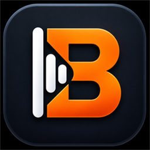

<h1 align="center">BoomBox</h1>

<b>La musique ensemble, en même temps, entre potes.</b> 
Bêta publique · Windows 10 et 11

<a href="https://github.com/myrmoon/boombox-releases/releases/latest/download/BoomBox.exe"><b>⬇ Télécharger BoomBox.exe</b></a>

BoomBox fait jouer la même musique, au même instant, sur les PC de tout un groupe : l'un héberge, les autres
rejoignent avec une invitation. Chaque PC télécharge lui-même ce qu'il joue, rien ne passe par Discord et
personne n'a à toucher à sa box.

- YouTube, YouTube Music, SoundCloud, Spotify (joué depuis YouTube Music), DI.fm, Mixcloud, Bandcamp, radios
- File d'attente commune, vote pour passer, like / dislike / favoris, playlists du groupe, historique
- Si l'hôte s'en va, un pote prend la suite tout seul : la musique continue
- Bot Discord optionnel : `/play`, `/skip`, `/invite`… sur votre serveur, tant que quelqu'un héberge

## Installer

1. Télécharge **BoomBox.exe** et lance-le. Rien à installer : c'est un seul fichier.
2. Windows peut afficher « Windows a protégé votre ordinateur » (l'exe n'est pas encore signé) :
   **Informations complémentaires → Exécuter quand même**.
3. Au premier lancement, BoomBox télécharge ses composants (~60 Mo : lecteur mpv, yt-dlp).

Les mises à jour arrivent ensuite d'elles-mêmes : un bandeau propose la nouvelle version, signée.

## Rejoindre des potes

Celui qui héberge t'envoie une invitation `boombox://…` (ou tape `/invite` sur votre Discord).
Dans BoomBox : **BIB → Réglages → Rejoindre**, colle le lien. C'est tout, BoomBox s'y reconnecte seule ensuite.

## Héberger

**BIB → Réglages → Session → Héberger une session**, puis envoie l'invitation affichée.
La connexion passe par un relais : aucun port à ouvrir.
Un relais ne sert qu'un groupe : si BoomBox te dit que le sien est déjà pris, crée le tien, gratuit, dans
**Réglages → Relais** (un compte Cloudflare gratuit suffit, BoomBox explique les étapes).

## Bêta

C'est une première version publique : des choses peuvent casser. Hôte et potes doivent avoir la même version.
Un souci ? Ouvre une *issue* sur ce dépôt en joignant `%LOCALAPPDATA%\BoomBox\boombox.log`.
